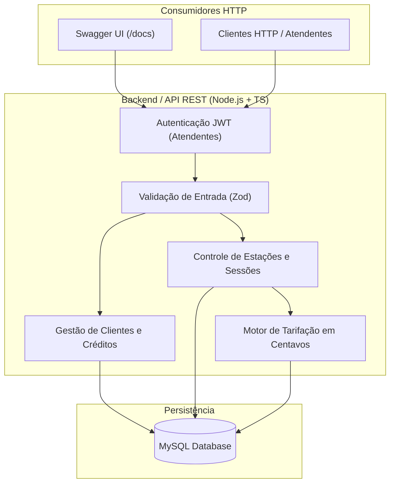
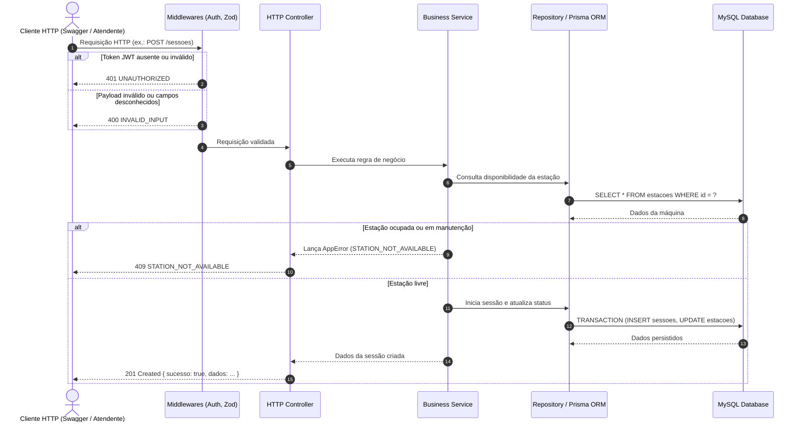
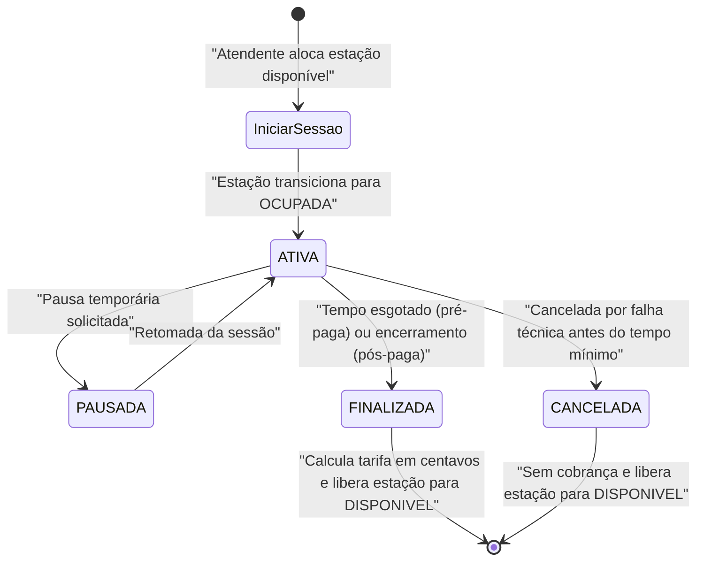

# Visão Geral da API

Visão geral arquitetural, padrões de comunicação, ciclo de vida de requisição e catálogo dos módulos da API REST.

- **Versão:** 1.0
- **Data:** 10/11/2026
- **Status:** aprovado

> [!NOTE]
> Este documento resume e ilustra o funcionamento da API REST da Lan House com diagramas. Ele consolida o fluxo de dados, esteira de middlewares e integração com o banco MySQL via Prisma ORM. Regras de negócio residem em [regrasDeNegocio.md](../negocio/regrasDeNegocio.md) e contratos em [contratos.md](../api/contratos.md).

---

## 1. Visão Geral da Arquitetura

O sistema opera como uma API RESTful centralizada, atendendo aos clientes HTTP e Swagger UI para gerenciamento de computadores e sessões:



---

## 2. Ciclo de Vida da Requisição na API

Toda requisição HTTP recebida pela API segue uma esteira bem definida de processamento:



---

## 3. Máquina de Estados da Sessão na API

O ciclo de vida de uma sessão e seu reflexo no status das estações:



---

## 4. Módulos Funcionais da API

| Módulo                  | Prefixo       | Responsabilidade                                                                                                |
| ------------------------ | ------------- | --------------------------------------------------------------------------------------------------------------- |
| **Autenticação** | `/auth`     | Login dos atendentes, validação de senha (bcrypt) e emissão de token JWT.                                    |
| **Clientes**       | `/clientes` | Cadastro, busca por CPF/nome, histórico e desativação lógica (soft delete).                                 |
| **Estações**     | `/estacoes` | Monitoramento em tempo real do estado das máquinas (`DISPONIVEL`, `OCUPADA`, `MANUTENCAO`, `INATIVA`). |
| **Sessões**       | `/sessoes`  | Início de uso (pré ou pós-paga), acompanhamento e encerramento com cálculo financeiro.                      |
| **Créditos**      | `/creditos` | Recargas, débitos automáticos de sessões e extrato de transações em centavos.                              |
| **Tarifas**        | `/tarifas`  | Configuração de preço por minuto em centavos de acordo com a categoria da máquina.                          |

---

## 5. Diretrizes de Comunicação e Contrato

1. **Envelope de Sucesso Padronizado:**
   ```json
   {
     "sucesso": true,
     "dados": { ... }
   }
   ```
2. **Envelope de Erro Único:**
   ```json
   {
     "sucesso": false,
     "erro": {
       "codigo": "STATION_NOT_AVAILABLE",
       "mensagem": "A estação informada não está disponível para iniciar sessão.",
       "detalhes": []
     }
   }
   ```
3. **Resiliência e Integridade:** Todas as operações que afetam saldo de clientes e ocupação de máquinas utilizam transações ACID do MySQL gerenciadas via `prisma.$transaction`.
