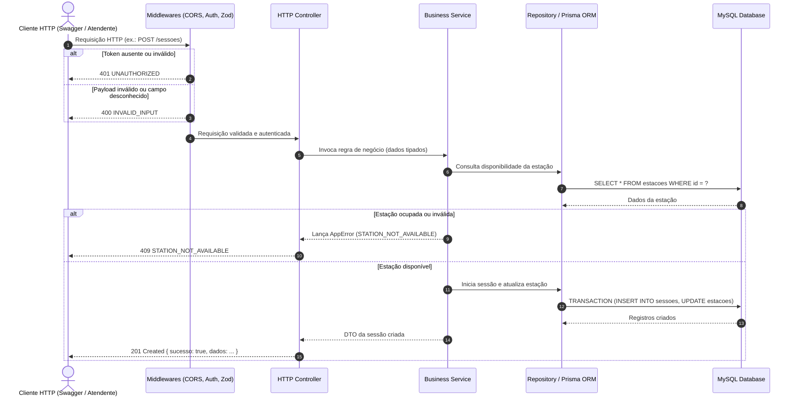

# Visão Geral da API

Visão geral arquitetural, padrões de comunicação, ciclo de vida de requisição e catálogo dos módulos da API REST.

- **Versão:** 1.0
- **Data:** 10/11/2026
- **Status:** aprovado

> [!NOTE]
> Este documento consolida a arquitetura da API REST da Lan House, detalhando o tráfego de requisições, a modularidade das rotas e a integração com o banco MySQL via Prisma ORM. Para contratos específicos de rotas e payloads, consulte [contratos.md](../api/contratos.md). Para regras de negócio, consulte [regrasDeNegocio.md](../negocio/regrasDeNegocio.md). Para a visão ilustrada com diagramas de estados, consulte também [visaoGeral.md](visaoGeral.md).

---

## 1. Objetivo e Princípios da API

A API da Lan House foi projetada como um serviço RESTful centralizado, operando sob o modelo cliente-servidor sem retenção de estado de sessão no servidor (*stateless*). Suas diretrizes essenciais são:

1. **Protocolo e Formato:** Comunicação sobre HTTP/1.1 ou HTTP/2, trafegando exclusivamente payloads em JSON com codificação UTF-8.
2. **Separação de Responsabilidades:** Camadas bem delineadas (HTTP Controller, Domínio Service e Persistência Repository/Prisma) evitando acoplamento.
3. **Imutabilidade e Segurança Financeira:** Cálculos de cobrança e saldos operam estritamente em centavos inteiros (`Centavos`) para evitar distorções de ponto flutuante.
4. **Precisão Temporal:** Todas as datas e horários de início/fim de sessões e transações são processados e armazenados em UTC no formato ISO-8601.
5. **Autenticação Direta:** Proteção por JSON Web Tokens (JWT) com perfil único simplificado para os atendentes da Lan House.

---

## 2. Ciclo de Vida de uma Requisição

Toda requisição que chega à API atravessa uma esteira sequencial de validações antes de alcançar o banco de dados MySQL:



---

## 3. Módulos Funcionais da API

A API é dividida em módulos autocontidos agrupados por recurso do domínio:

```text
api/
├── /auth          ── Autenticação de atendentes e geração de token JWT
├── /clientes      ── Cadastro, listagem, atualização e inativação lógica de clientes
├── /estacoes      ── Monitoramento em tempo real e cadastro de computadores do salão
├── /sessoes       ── Abertura, cálculo de tempo e encerramento de sessões (pré e pós-paga)
├── /creditos      ── Recargas financeiras, saldo e extrato de transações
└── /tarifas       ── Consulta e manutenção de valores por minuto por categoria
```

### 3.1 Módulo de Autenticação (`/auth`)

- **Responsabilidade:** Receber credenciais do atendente (login e senha), verificar hash seguro via bcrypt e emitir token JWT de acesso.
- **Segurança:** Rate-limiting na rota `/auth/login` para prevenção de ataques de força bruta.

### 3.2 Módulo de Clientes (`/clientes`)

- **Responsabilidade:** Manter a base de clientes da Lan House (nome, documento único CPF, telefone).
- **Regras:** Não permite exclusão física caso haja histórico; implementa desativação lógica (*soft delete*).

### 3.3 Módulo de Estações (`/estacoes`)

- **Responsabilidade:** Representar cada máquina física disponível no salão, seu número, categoria (`PADRAO`, `VIP_GAMER`) e estado atual (`DISPONIVEL`, `OCUPADA`, `MANUTENCAO`, `INATIVA`).
- **Uso:** Alimenta a grade visual em tempo real do balcão de atendimento.

### 3.4 Módulo de Sessões (`/sessoes`)

- **Responsabilidade:** Orquestrar o uso das estações de trabalho.
- **Modalidades Suportadas:**
  - **Pré-paga (`PRE_PAGA`):** O cliente contrata tempo fixo ou consome de seus créditos prévios; encerra automaticamente ao esgotar.
  - **Pós-paga (`POS_PAGA`):** O tempo corre livremente até a solicitação de fechamento no balcão.

### 3.5 Módulo de Créditos e Tarifas (`/creditos`, `/tarifas`)

- **Responsabilidade:** Gestão da carteira pré-paga do cliente e registro contábil imutável de todas as recargas e estornos em centavos (`saldoCentavos`).

---

## 4. Padronização de Contratos HTTP

### 4.1 Resposta de Sucesso

Envelope padrão para todas as rotas da API:

```json
{
  "sucesso": true,
  "dados": { ... }
}
```

### 4.2 Resposta de Erro Unificada

Nenhum erro interno ou exceção de banco de dados é vazado para o cliente:

```json
{
  "sucesso": false,
  "erro": {
    "codigo": "INSUFFICIENT_FUNDS",
    "mensagem": "Saldo de créditos insuficiente para abrir sessão pré-paga.",
    "detalhes": []
  }
}
```

---

## 5. Resiliência e Integridade de Dados

1. **Transações ACID:** Abertura e encerramento de sessões utilizam transações gerenciadas pelo Prisma ORM (`prisma.$transaction`), garantindo que o status da estação e o registro da sessão nunca fiquem em estado inconsistente.
2. **Camada Única de Erros:** Exceções conhecidas utilizam a classe customizada `AppError`. Quaisquer erros não tratados são interceptados pelo `ErrorHandler` global, retornando HTTP 500 sem expor stack traces.
3. **Conexão MySQL:** O pool de conexões é gerenciado de forma segura pelo Prisma Client, otimizado para o ambiente de desenvolvimento e testes isolados.
