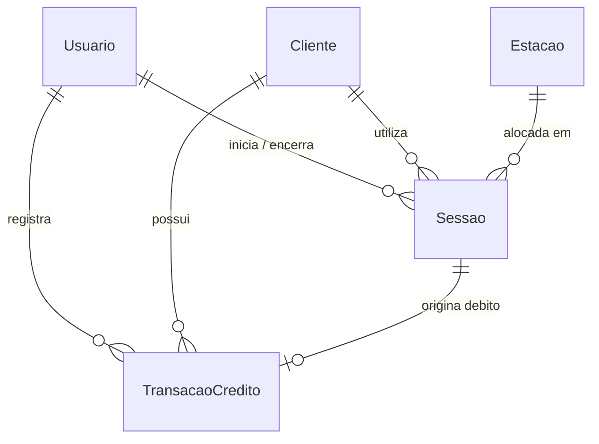

# Modelo de Dados

Estrutura de tabelas, campos, tipos, relacionamentos e regras de integridade do banco de dados.

- **Versão:** 1.0
- **Data:** 10/11/2026
- **Status:** aprovado

## 1. Princípios do Banco de Dados

1. **Identificadores (`id`):** Chave primária presente em todos os models (ex.: UUIDv4 ou CUID string).
2. **Datas em UTC:** Todos os campos temporais (`criadoEm`, `atualizadoEm`, `iniciadoEm`, `finalizadoEm`) são armazenados em UTC no formato `DATETIME` ou `TIMESTAMP` do MySQL.
3. **Dinheiro em centavos:** Proibido o uso de `FLOAT` ou `DOUBLE` para valores monetários. Todos os valores são armazenados como inteiros (`INTEGER` ou `BIGINT`) com o sufixo `Centavos`.
4. **Nada é apagado (Soft Delete):** Tabelas cadastrais (`Cliente`, `Estacao`, `Usuario`) possuem coluna `ativo` (`BOOLEAN`) ou `desativadoEm` (`TIMESTAMP NULL`). Transações e histórico de sessões são estritamente imutáveis.
5. **Nomenclatura:** Models no singular e PascalCase; colunas em camelCase.

## 2. Tabelas / Entidades

### 2.1 `Usuario` (Operadores e Administradores)

Tabela de credenciais para acesso ao sistema.

| Campo            | Tipo             | Nulo | Observação                                |
| ---------------- | ---------------- | ---- | ------------------------------------------- |
| `id`           | `VARCHAR(36)`  | Não | Chave primária (UUID).                     |
| `nome`         | `VARCHAR(100)` | Não | Nome completo do usuário.                  |
| `login`        | `VARCHAR(50)`  | Não | Nome de login único.                       |
| `senhaHash`    | `VARCHAR(255)` | Não | Hash da senha (bcrypt/argon2).              |
| `perfil`       | `VARCHAR(20)`  | Não | `ATENDENTE` (perfil simplificado único). |
| `ativo`        | `BOOLEAN`      | Não | Padrão `true`.                           |
| `criadoEm`     | `TIMESTAMP`    | Não | Data de criação em UTC.                   |
| `atualizadoEm` | `TIMESTAMP`    | Não | Data da última alteração em UTC.         |

### 2.2 `Cliente`

Pessoas que utilizam os computadores da Lan House.

| Campo             | Tipo             | Nulo | Observação                           |
| ----------------- | ---------------- | ---- | -------------------------------------- |
| `id`            | `VARCHAR(36)`  | Não | Chave primária (UUID).                |
| `nome`          | `VARCHAR(120)` | Não | Nome completo do cliente.              |
| `documento`     | `VARCHAR(20)`  | Não | CPF ou documento oficial (único).     |
| `telefone`      | `VARCHAR(20)`  | Sim  | Telefone de contato.                   |
| `email`         | `VARCHAR(120)` | Sim  | E-mail para contato ou notificações. |
| `saldoCentavos` | `INTEGER`      | Não | Saldo atual em centavos (padrão 0).   |
| `ativo`         | `BOOLEAN`      | Não | Padrão `true` (soft delete).        |
| `criadoEm`      | `TIMESTAMP`    | Não | Data de criação em UTC.              |
| `atualizadoEm`  | `TIMESTAMP`    | Não | Data da última alteração em UTC.    |

### 2.3 `Estacao`

Computadores e terminais físicos disponíveis no salão.

| Campo            | Tipo            | Nulo | Observação                                              |
| ---------------- | --------------- | ---- | --------------------------------------------------------- |
| `id`           | `VARCHAR(36)` | Não | Chave primária (UUID).                                   |
| `numero`       | `INTEGER`     | Não | Número da estação no salão (único).                  |
| `nome`         | `VARCHAR(50)` | Não | Ex.: "Estação 01", "Gamer VIP 02".                      |
| `categoria`    | `VARCHAR(20)` | Não | Categorias padronizadas: `COMUM`, `GAMER`, `HIGH_END`. |
| `status`       | `VARCHAR(20)` | Não | `DISPONIVEL`, `OCUPADA`, `MANUTENCAO`, `INATIVA`. |
| `ipHost`       | `VARCHAR(45)` | Não  | Endereço IP fixo pré-definido da máquina (único).      |
| `ativo`        | `BOOLEAN`     | Não | Padrão `true`.                                         |
| `criadoEm`     | `TIMESTAMP`   | Não | Data de criação em UTC.                                 |
| `atualizadoEm` | `TIMESTAMP`   | Não | Data da última alteração em UTC.                       |

### 2.4 `Tarifa`

Regras de preço por minuto de acordo com a categoria de máquina.

| Campo                      | Tipo            | Nulo | Observação                           |
| -------------------------- | --------------- | ---- | -------------------------------------- |
| `id`                     | `VARCHAR(36)` | Não | Chave primária.                       |
| `categoria`              | `VARCHAR(20)` | Não | Categoria correspondente (`COMUM`, `GAMER`, `HIGH_END`). |
| `valorPorMinutoCentavos` | `INTEGER`     | Não | Valor por minuto em centavos.          |
| `ativo`                  | `BOOLEAN`     | Não | Padrão `true`.                      |
| `criadoEm`               | `TIMESTAMP`   | Não | Data de vigência inicial em UTC.      |
| `atualizadoEm`           | `TIMESTAMP`   | Não | Data de atualização em UTC.          |

### 2.5 `Sessao`

Histórico de sessões de uso dos clientes nas estações.

| Campo                  | Tipo            | Nulo | Observação                                           |
| ---------------------- | --------------- | ---- | ------------------------------------------------------ |
| `id`                 | `VARCHAR(36)` | Não | Chave primária (UUID).                                |
| `clienteId`          | `VARCHAR(36)` | Não | FK para `Cliente(id)`.                               |
| `estacaoId`          | `VARCHAR(36)` | Não | FK para `Estacao(id)`.                               |
| `operadorInicioId`   | `VARCHAR(36)` | Não | FK para `Usuario(id)`.                               |
| `operadorFimId`      | `VARCHAR(36)` | Sim  | FK para `Usuario(id)`.                               |
| `modalidade`         | `VARCHAR(20)` | Não | `PRE_PAGA` ou `POS_PAGA`.                          |
| `status`             | `VARCHAR(20)` | Não | `ATIVA`, `PAUSADA`, `FINALIZADA`, `CANCELADA`. |
| `iniciadoEm`         | `TIMESTAMP`   | Não | Início exato em UTC.                                  |
| `finalizadoEm`       | `TIMESTAMP`   | Sim  | Fim exato em UTC.                                      |
| `minutosContratados` | `INTEGER`     | Sim  | Limite de minutos em sessões pré-pagas.              |
| `minutosUtilizados`  | `INTEGER`     | Sim  | Duração real final em minutos.                       |
| `valorFinalCentavos` | `INTEGER`     | Sim  | Total cobrado em centavos.                             |
| `pagoComSaldo`       | `BOOLEAN`     | Não | Padrão `false`.                                     |

### 2.6 `TransacaoCredito`

Histórico imutável de movimentações financeiras de crédito do cliente.

| Campo                 | Tipo            | Nulo | Observação                                                   |
| --------------------- | --------------- | ---- | -------------------------------------------------------------- |
| `id`                | `VARCHAR(36)` | Não | Chave primária (UUID).                                        |
| `clienteId`         | `VARCHAR(36)` | Não | FK para `Cliente(id)`.                                       |
| `operadorId`        | `VARCHAR(36)` | Não | FK para `Usuario(id)`.                                       |
| `sessaoId`          | `VARCHAR(36)` | Sim  | FK para `Sessao(id)` quando for débito de uso.              |
| `tipo`              | `VARCHAR(20)` | Não | `RECARGA`, `DEBITO_SESSAO`, `ESTORNO`, `AJUSTE`.       |
| `valorCentavos`     | `INTEGER`     | Não | Valor da operação em centavos (sempre positivo).             |
| `saldoAposCentavos` | `INTEGER`     | Não | Saldo resultante do cliente em centavos.                       |
| `criadoEm`          | `TIMESTAMP`   | Não | Data da transação em UTC (tabela de fato, sem atualizadoEm). |

## 3. Relacionamentos e Integridade

